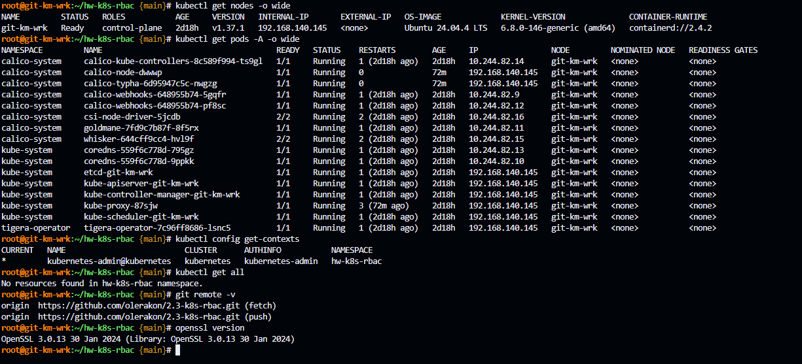
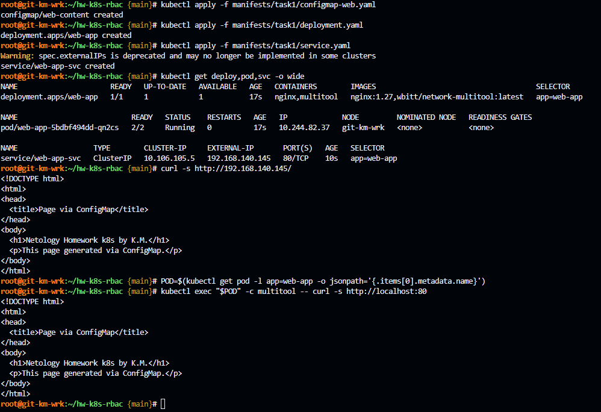
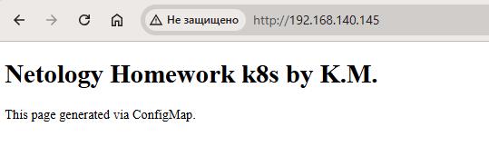
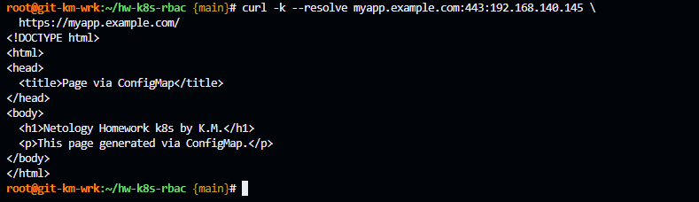
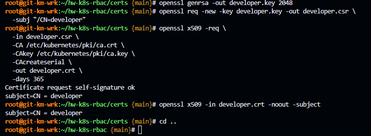
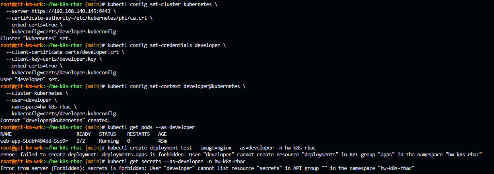

# Домашнее задание к занятию «Настройка приложений и управление доступом в Kubernetes»

## Предварительная информация

На VM Ubuntu 24.04 LTS был развернут полноценный kubernetes версии 1.37.1 в формате all-in-one-single-node средствами kubeadm.

IP адресс машины 192.168.140.145

В качестве сетевого плагина был выбран calico. Network cidr: 10.244.0.0/16

Так же был инициализирован гит [репозиторий](https://github.com/olerakon/2.3-k8s-rbac) проекта 

Для домашнего задания был создан отдельный ns: `hw-k8s-rbac` и настроена дефолтная работа в нем через kubectl.

Сводная информация представлена на скриншоте:



------

## **Задание 1: Работа с ConfigMaps**
### **Задача**
Развернуть приложение (nginx + multitool), решить проблему конфигурации через ConfigMap и подключить веб-страницу.

### **Шаги выполнения**
1. **Создать Deployment** с двумя контейнерами
   - `nginx`
   - `multitool`
2. **Подключить веб-страницу** через ConfigMap
3. **Проверить доступность**

### **Что сдать на проверку**
- Манифесты:
  - `deployment.yaml`
  - `configmap-web.yaml`
- Скриншот вывода `curl` или браузера

------

### Решение

Развернул приложение (nginx + multitool), решить проблему конфигурации через ConfigMap и подключить веб-страницу.

1. Создал [Deployment](./manifests/task1/deployment.yaml) с двумя контейнерами
   - `nginx`
   - `multitool`
2. Подключил веб-страницу через [ConfigMap](./manifests/task1/configmap-web.yaml)
3. Дополнительно создал [Service](./manifests/task1/service.yaml) типа ExternalIP.
4. Проверил доступность





------

---
## **Задание 2: Настройка HTTPS с Secrets**  
### **Задача**  
Развернуть приложение с доступом по HTTPS, используя самоподписанный сертификат.

### **Шаги выполнения**  
1. **Сгенерировать SSL-сертификат**
```bash
openssl req -x509 -nodes -days 365 -newkey rsa:2048 \
  -keyout tls.key -out tls.crt -subj "/CN=myapp.example.com"
```
2. **Создать Secret**
3. **Настроить Ingress**
4. **Проверить HTTPS-доступ**

### **Что сдать на проверку**  
- Манифесты:
  - `secret-tls.yaml`
  - `ingress-tls.yaml`
- Скриншот вывода `curl -k`

---

------

### Решение

Развернул приложение с доступом по HTTPS, используя самоподписанный сертификат.

1. Сгенерировал SSL-сертификат
```bash
openssl req -x509 -nodes -days 365 -newkey rsa:2048 \
  -keyout tls.key -out tls.crt -subj "/CN=myapp.example.com"
```
2. Создал [Secret](./manifests/task2/secret-tls.yaml)
3. Установил и настроил [Ingress](./manifests/task2/ingress-tls.yaml)
```bash
kubectl apply -f https://raw.githubusercontent.com/kubernetes/ingress-nginx/controller-v1.15.1/deploy/static/provider/cloud/deploy.yaml
kubectl patch deployment ingress-nginx-controller \
  -n ingress-nginx \
  --type=strategic \
  -p '
spec:
  template:
    spec:
      hostNetwork: true
      dnsPolicy: ClusterFirstWithHostNet
'
```
4. Проверил HTTPS-доступ



------

---
## **Задание 3: Настройка RBAC**  
### **Задача**  
Создать пользователя с ограниченными правами (только просмотр логов и описания подов).

### **Шаги выполнения**  
1. **Включите RBAC в microk8s**
```bash
microk8s enable rbac
```
2. **Создать SSL-сертификат для пользователя**
```bash
openssl genrsa -out developer.key 2048
openssl req -new -key developer.key -out developer.csr -subj "/CN={ИМЯ ПОЛЬЗОВАТЕЛЯ}"
openssl x509 -req -in developer.csr -CA {CA серт вашего кластера} -CAkey {CA ключ вашего кластера} -CAcreateserial -out developer.crt -days 365
```
3. **Создать Role (только просмотр логов и описания подов) и RoleBinding**
4. **Проверить доступ**

### **Что сдать на проверку**  
- Манифесты:
  - `role-pod-reader.yaml`
  - `rolebinding-developer.yaml`
- Команды генерации сертификатов
- Скриншот проверки прав (`kubectl get pods --as=developer`)

---

------

### Решение

Создал пользователя с ограниченными правами (только просмотр логов и описания подов).

1. Создал SSL-сертификат для пользователя
```bash
openssl genrsa -out developer.key 2048
openssl req -new -key developer.key -out developer.csr -subj "/CN=developer"
openssl x509 -req -in developer.csr -CA /etc/kubernetes/pki/ca.crt -CAkey /etc/kubernetes/pki/ca.key -CAcreateserial -out developer.crt -days 365
```



2. Создать [Role](./manifests/task3/role-pod-reader.yaml) (только просмотр логов и описания подов) и [RoleBinding](./manifests/task3/rolebinding-developer.yaml)
3. Создал отдельный kubeconfig и проверил доступ



------
